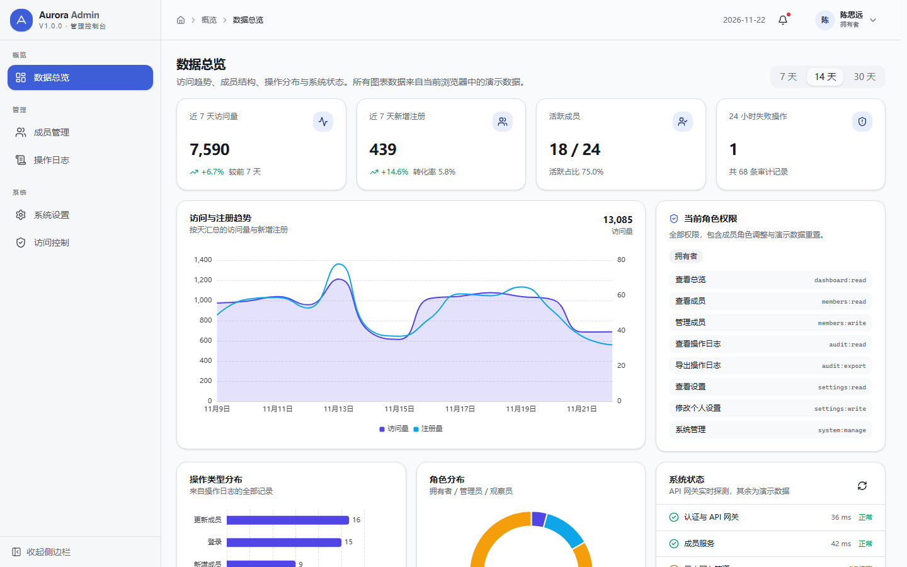
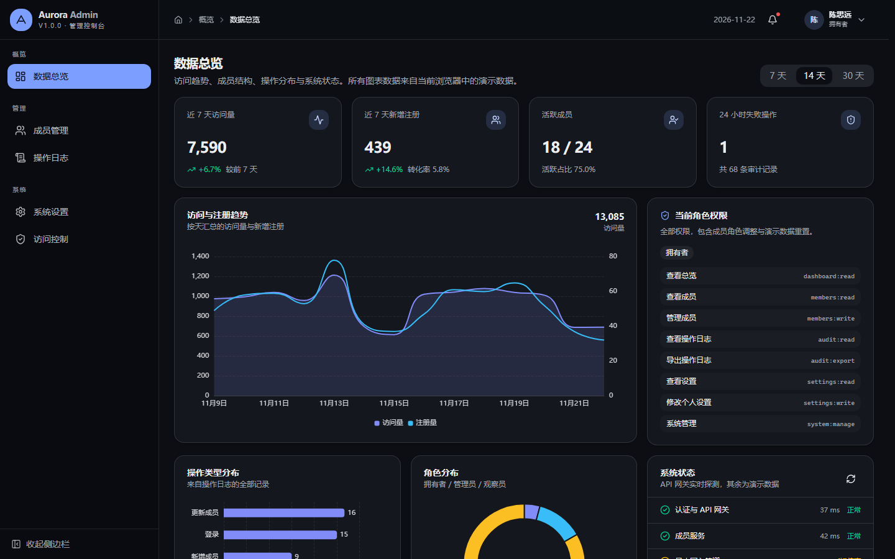
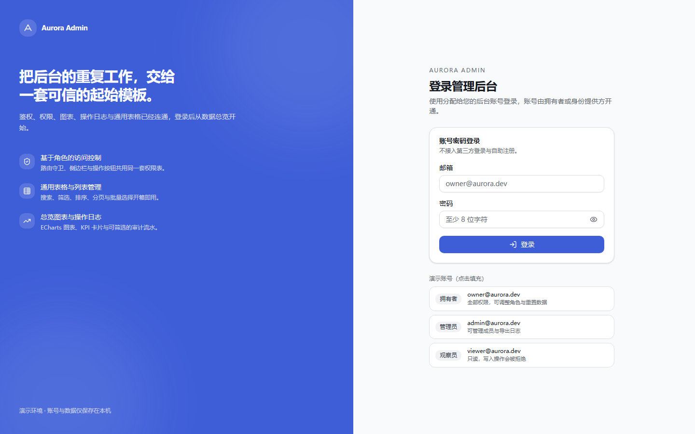
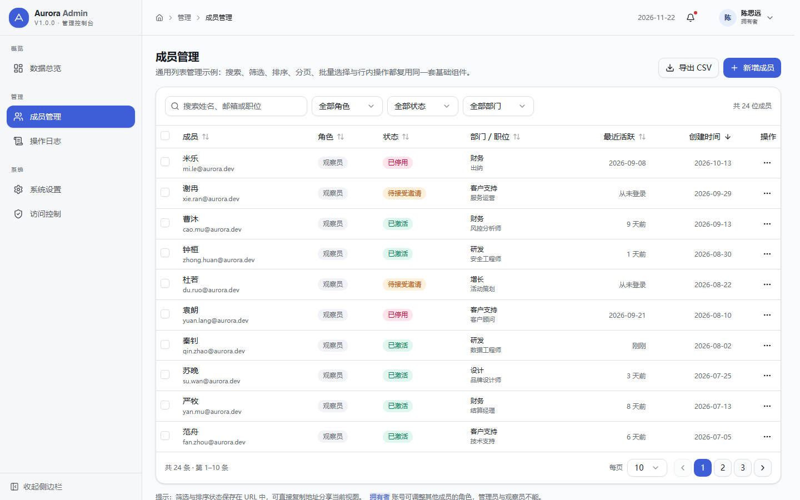
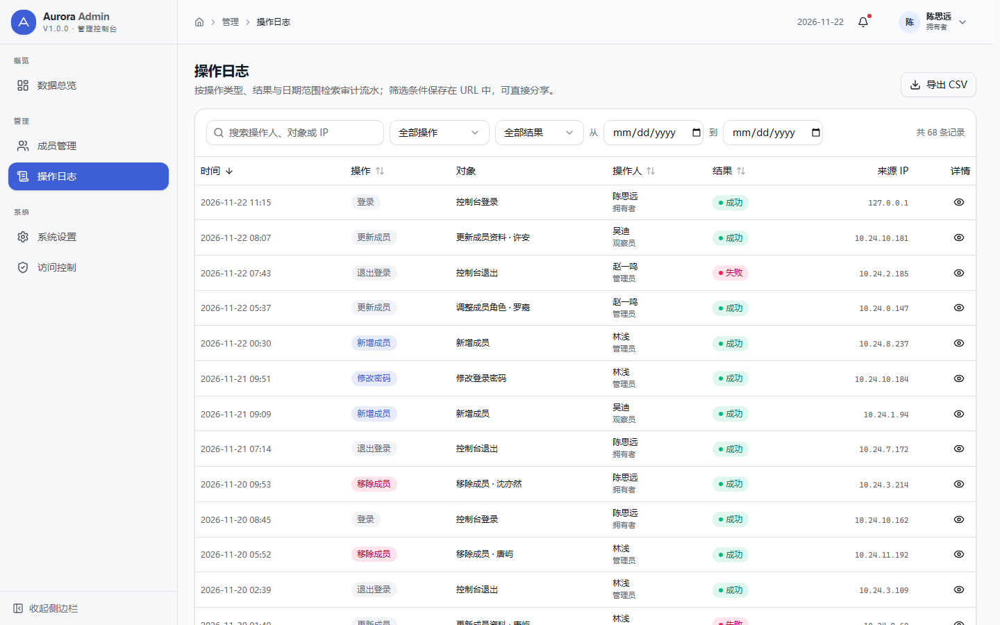
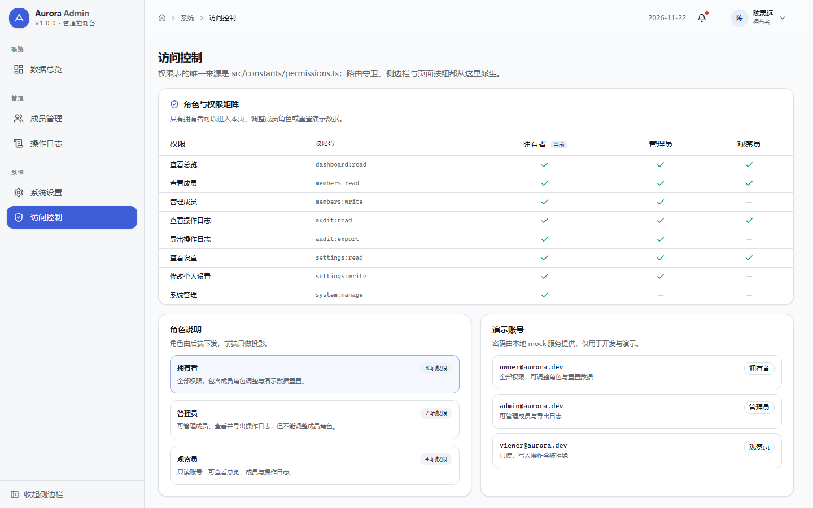

# Aurora Admin · Vue 3 + Vite + TypeScript 管理后台起始模板

一个可直接运行、可持续演进的 **Web 管理后台**示例：Vue 3.5、Vite 8、TypeScript 7、Pinia、Vue Router、Tailwind CSS 4 与 **shadcn-vue**（reka-ui）。内置鉴权与路由拦截、基于角色的访问控制（RBAC）、总览图表、操作日志、通用表格与通用列表管理。

模板面向**桌面端 + 简体中文**：没有移动端抽屉导航，也没有 i18n 双语包。这是有意的产品决策，理由见 [architecture.md §10](./docs/architecture.md#10-桌面端与单语言决策)。



<details>
  <summary>深色模式、登录页与列表页截图</summary>











</details>

## 文档与协作

| 文档                                                         | 内容                                          |
| ------------------------------------------------------------ | --------------------------------------------- |
| [AGENTS.md](./AGENTS.md)                                     | Agent 协作硬性规则、架构红线、完成定义        |
| [specs/README.md](./specs/README.md)                         | 功能规格、计划、任务与验收流程                |
| [docs/README.md](./docs/README.md)                           | 工程文档索引与文档治理规则                    |
| [docs/architecture.md](./docs/architecture.md)               | 分层、RBAC、路由守卫、数据流与扩展位置        |
| [docs/engineering.md](./docs/engineering.md)                 | 环境、脚本、质量门禁、依赖与编码约束          |
| [docs/data-adapters.md](./docs/data-adapters.md)             | Repository 接口、三适配器、换后端契约         |
| [docs/components/](./docs/components/README.md)              | 通用表格、弹窗、按钮与 Toast 的键盘/ARIA 契约 |
| [docs/framework-changelog.md](./docs/framework-changelog.md) | 非业务层框架变更的追加式记录                  |

> **硬性约束：任何非业务层的框架功能变更，都必须在同一次变更中更新 [框架变更记录](./docs/framework-changelog.md)，并按 [文档更新矩阵](./AGENTS.md#31-强制文档更新矩阵) 更新受影响的文档。没有同步文档的框架变更视为未完成。**
> CI 会通过 `pnpm docs:check` 校验关键文档存在性和相对链接。

## 快速开始

要求 **Node.js `^22.22.2 || ^24.15.0 || >=26.0.0`**（推荐 Node 24 LTS）与 **pnpm 12.21.0**（`packageManager` 已固定该版本，corepack 会自动切换；版本不符时 pnpm 直接报错）。

```bash
corepack enable
corepack prepare pnpm@12.21.0 --activate
pnpm install
pnpm dev
```

打开 <http://localhost:5173>，使用三个演示账号之一登录（点击登录页的「演示账号」即可填充）：

| 角色   | 邮箱                | 密码               | 能力                                                 |
| ------ | ------------------- | ------------------ | ---------------------------------------------------- |
| 拥有者 | `owner@aurora.dev`  | `AuroraOwner123!`  | 全部权限：成员、日志、角色调整、访问控制、重置数据   |
| 管理员 | `admin@aurora.dev`  | `AuroraAdmin123!`  | 管理成员、导出日志；不能进入访问控制或授予拥有者角色 |
| 观察员 | `viewer@aurora.dev` | `AuroraViewer123!` | 只读：浏览总览、成员与日志，看不到写操作入口         |

账号数据写入本地 `.data/auth-users.json`（已 Git 忽略），密码用 `scrypt` 哈希。该服务**不是生产后端**，生产需接入真实 `/api/auth/*`。

需要对接真实后端时，用同源代理模式避免本地 CORS 配置：

```bash
pnpm dev:proxy   # 读取 .env.proxy 的 API_PROXY_TARGET，转发 /api 到真实后端
```

生产构建与本地预览：

```bash
pnpm build
pnpm preview
```

## 功能

- **登录与会话**：邮箱密码登录、会话恢复、退出登录、显示名称与密码修改；账号由拥有者开通，不做自助注册。
- **路由拦截**：未登录访问受保护页面跳转 `/login?redirect=...` 并在登录后回跳；已登录用户不能回到登录页；缺少权限跳转 `/403`。
- **基于角色的访问控制**：单一权限表派生路由守卫、侧边栏可见性、按钮可用性与业务规则；`/access` 页面展示角色 × 权限矩阵。
- **就地续签**：会话在使用中过期时保留当前页面与已填内容，用登录弹窗完成续签并重放被中断的操作。
- **总览图表**：KPI 卡片、访问/注册趋势（7/14/30 天）、操作类型分布、角色分布、系统状态与最近操作；ECharts 按模块注册并单独分块。
- **操作日志**：按操作类型、结果、日期范围与关键词检索；支持排序、分页、CSV 导出与详情弹窗；`?detail=<id>` 可直接分享单条记录。
- **通用表格**：`DataTable` 提供列定义、排序（`aria-sort`）、行选择、加载骨架与空状态，单元格通过 `#cell-<key>` 插槽扩展。
- **通用列表管理**：`useListQuery` + `useResourceList` 统一搜索、筛选、排序、分页与选择，并把状态写进 URL，刷新与分享都可用。
- **成员管理**：新增、编辑、停用/启用、批量移除、CSV 导出；邮箱唯一性、拥有者不可移除、角色变更仅拥有者等规则在 Store 与 UI 双向约束。
- **系统设置**：账号资料、登录密码、主题（浅色/深色/跟随系统）、后端连接检测、演示数据重置与关于信息。
- **审计写入**：登录、退出、成员增删改、设置修改、导出与重置都会追加一条审计记录（演示用前端写入，生产必须服务端写入）。
- **外观**：shadcn-vue 设计 Token（oklch）驱动明暗主题，`index.html` 内联脚本消除首屏闪烁。
- **工程化**：严格 TypeScript（含 `noUncheckedIndexedAccess`）、ESLint + Oxlint + Prettier、Vitest、Playwright、GitHub Actions、可复现发布脚本。

## 技术栈

| 类别       | 选型                                      | 版本                |
| ---------- | ----------------------------------------- | ------------------- |
| 框架       | Vue（Composition API + `<script setup>`） | 3.5.46              |
| 构建       | Vite（Rolldown）                          | 8.3.8               |
| 编译器     | TypeScript 7 + TS 6 兼容层                | 7.0.2 / 6.0.2       |
| 类型检查   | vue-tsc（Vue SFC）                        | 3.3.14              |
| 路由       | Vue Router（history 模式、路由懒加载）    | 5.5.1               |
| 状态       | Pinia（Setup Store）                      | 4.1.0               |
| UI         | shadcn-vue（vendored）+ reka-ui + cva     | — / 2.11.0 / 0.7.1  |
| 样式       | Tailwind CSS 4 + `@tailwindcss/vite`      | 4.3.5               |
| 图表       | ECharts（模块化注册）                     | 6.1.0               |
| HTTP       | Axios（实例 + 请求/响应拦截器）           | 1.21.1              |
| 数据校验   | Zod                                       | 4.6.7               |
| 组合式工具 | VueUse                                    | 15.0.0              |
| 图标       | Lucide（`@lucide/vue`）                   | 1.77.0              |
| PWA        | vite-plugin-pwa（Workbox 预缓存）         | 2.0.0               |
| 单元测试   | Vitest + Vue Test Utils + jsdom           | 5.1.1 / 31.0.1      |
| 端到端测试 | Playwright                                | 1.65.1              |
| 代码质量   | ESLint + Oxlint + Prettier                | 10.15 / 1.94 / 3.10 |
| 运行时     | Node.js + pnpm                            | 24 LTS / 12.21.0    |

### TypeScript 7 的官方并存方案

TypeScript 7 是 Go 原生编译器，`tsc` 构建速度显著提升，但暂时不再暴露完整的旧版 Compiler API，而 `vue-tsc` 与 `typescript-eslint` 仍依赖该 API。项目采用 [TypeScript 官方推荐的别名并存方式](https://devblogs.microsoft.com/typescript/announcing-typescript-7-0/#running-side-by-side-with-typescript-6.0)：

```json
{
  "@typescript/native": "npm:typescript@^7.0.2",
  "typescript": "npm:@typescript/typescript6@^6.0.2"
}
```

```bash
pnpm exec tsc --version    # Version 7.0.2
pnpm exec tsc6 --version   # Version 6.0.3
pnpm type-check            # TS7 检查 .ts / 配置，vue-tsc 使用 TS6 API 检查 SFC
```

当 `vue-tsc` 与 `typescript-eslint` 完整支持 TS 7 API 后，可以移除兼容层、`types/vue-shim.d.ts` 与 `tsconfig.typecheck.json`。

## 工程结构

```text
.
├── .github/workflows/ci.yml     # 文档、格式、Lint、类型、单测、构建、E2E
├── AGENTS.md                    # Agent 协作硬性规则
├── deploy/                      # 可复现构建、S3 发布、Nginx 示例
├── docs/                        # 架构、工程、数据适配、组件契约、变更记录、截图
├── e2e/                         # Playwright：auth / rbac / members / audit / dashboard / settings / layout
├── public/                      # favicon 与 PWA 图标
├── scripts/                     # 文档检查、纯转发组件检查、截图与图标再生成
├── server/admin-api-mock.ts     # 仅开发/预览/E2E 的本地鉴权 API（三种角色）
├── specs/                       # 规格、计划、任务与验收
└── src/
    ├── __tests__/               # Vitest 测试与 setup
    ├── api/                     # http / errors / envelope / token / repository / auth / members / audit / system
    ├── assets/main.css          # Tailwind 入口与 shadcn-vue Design Token
    ├── components/
    │   ├── ui/                  # shadcn-vue 基础组件（vendored）+ 全局 loading / toast / 主题切换
    │   ├── layout/              # 侧边栏、导航、顶栏、账号菜单
    │   ├── charts/              # BaseChart（ECharts 封装）与 ChartCard
    │   ├── data-table/          # DataTable / Toolbar / Pagination 与列类型
    │   ├── common/              # PageHeader、StatCard、ConfirmDialog
    │   ├── dashboard/           # 趋势图、分布图、最近操作、系统状态、角色权限卡
    │   ├── members/             # 成员表单弹窗与徽标
    │   ├── audit/               # 审计徽标与详情弹窗
    │   ├── settings/            # 设置页卡片
    │   └── auth/                # 就地登录弹窗
    ├── composables/             # 权限、列表状态、主题、Toast、侧边栏、登录表单
    ├── config/env.ts            # 运行时环境变量校验（Zod）
    ├── constants/               # 权限表、导航、成员/审计标签、演示账号、图表色板
    ├── data/                    # 零配置演示数据（成员、审计、趋势）
    ├── lib/                     # cn()、ECharts 注册、随机数、表单校验、图表主题
    ├── router/                  # 路由表与守卫
    ├── stores/                  # Auth、Members、Audit、Health、Loading、LoginDialog
    ├── types/                   # Zod Schema 与领域类型（含 RouteMeta 扩展）
    ├── utils/                   # 日期、数字、CSV、API 错误文案、redirect、缓存
    ├── views/                   # 每个地址一个目录，入口固定 index.vue
    └── layouts/                 # DefaultLayout（后台壳）/ AuthLayout（登录壳）
```

## 常用脚本

```bash
pnpm dev                # 开发服务器（含本地鉴权 mock）
pnpm dev:proxy          # 同源代理到真实后端（.env.proxy）
pnpm build              # 类型检查 + 生产构建
pnpm preview            # 预览生产产物
pnpm verify             # docs → format → lint → type-check → unit → build
pnpm test:e2e           # Playwright（自管 dev server）
pnpm docs:screens       # 依据当前 UI 重新生成 README 截图与 PWA 图标（需先启动 dev）
pnpm check:components   # 纯转发组件检查（已并入 pnpm lint）
bash deploy/build.sh    # 可复现发布构建
bash deploy/publish.sh  # 发布到 S3（需要 S3_BUCKET）
```

完整命令、质量门禁与故障处理见 [docs/engineering.md](./docs/engineering.md#3-命令)。

### 运行 E2E

```bash
pnpm exec playwright install chromium
pnpm test:e2e
```

网络无法下载浏览器时，可复用系统浏览器：

```powershell
$env:PLAYWRIGHT_CHANNEL = "msedge"   # 或 "chrome"
pnpm test:e2e
```

CI 中设置 `CI=true` 后，Playwright 使用 `pnpm preview` 测试真实生产产物。

## 鉴权与权限

### 登录链路

1. `/login` 提交邮箱密码 → `POST /api/auth/login` 返回 `{ token, user }`（user 含 `role`）。
2. Token 存入 `aurora.access-token.v1`，Axios 请求拦截器注入 `Authorization`、`X-Request-Id` 与 `Accept-Language`。
3. 首次导航时守卫调用 `/auth/me` 恢复会话；刷新页面不会掉登录态。
4. 任意 401 由 `src/api/http.ts` 统一判定：清理 token、派发 `aurora:unauthorized`，`main.ts` 清理 Store 并打开就地登录弹窗。

### 权限模型

权限表在 [`src/constants/permissions.ts`](./src/constants/permissions.ts)，是路由、导航与按钮的唯一来源：

| 权限             | 拥有者 | 管理员 | 观察员 |
| ---------------- | :----: | :----: | :----: |
| `dashboard:read` |   ✅   |   ✅   |   ✅   |
| `members:read`   |   ✅   |   ✅   |   ✅   |
| `members:write`  |   ✅   |   ✅   |   —    |
| `audit:read`     |   ✅   |   ✅   |   ✅   |
| `audit:export`   |   ✅   |   ✅   |   —    |
| `settings:read`  |   ✅   |   ✅   |   ✅   |
| `settings:write` |   ✅   |   ✅   |   —    |
| `system:manage`  |   ✅   |   —    |   —    |

- 路由的 `meta.permission` 与侧边栏条目的 `permission` 由 `src/__tests__/permissions.spec.ts` 强制对齐。
- 页面内用 `usePermission().can('members:write')` 控制按钮，用 `can('system:manage')` 控制角色授予与演示数据重置。
- **前端权限只决定体验**：生产后端必须对每个接口独立鉴权。

### 演示账号与本地 mock

[`server/admin-api-mock.ts`](./server/admin-api-mock.ts) 提供 `/api/auth/login|me|profile|password|logout` 与 `/api/health`，内置三种角色的演示账号，数据落在 `.data/auth-users.json`。它只服务于本地开发、预览与 E2E，不会进入静态产物。

### Token 说明

示例把 access token 放在 `localStorage`，便于演示请求拦截器。生产更推荐 HttpOnly、Secure、SameSite Cookie；若使用 Cookie，请移除本地 token 注入并设置合适的 `withCredentials` 与 CSRF 策略。

## 通用表格与列表管理

一个列表页需要的东西被拆成三层，成员管理与操作日志都是薄组合：

```text
useListQuery(defaults, allowed)      // URL 是唯一状态载体：写 replace、默认值不写进 URL
        └── useResourceList(rows, search, filters, sorters)
                ├── filteredRows / rows / page / pageCount / sortKey / sortDir
                └── selectedIds / toggleRow / toggleAllOnPage / removeFromSelection
                        └── DataTable + DataTableToolbar + DataTablePagination
```

- **列定义**是纯数据（`{ key, header, sortable, align }`），单元格用 `#cell-<key>` 插槽渲染，避免为每个资源复制一份表格。
- 排序通过表头按钮触发，`th[aria-sort]` 同步；分页、每页条数与筛选都写进 URL。
- 行选择支持跨页保留与批量操作；删除后调用 `removeFromSelection()` 清理失效 id。
- 两端实现：成员页有行内操作菜单与批量移除，日志页有日期范围与详情深链。

行为契约与键盘/ARIA 约定见 [docs/components/data-table.md](./docs/components/data-table.md)。

## 图表

- [`src/lib/echarts.ts`](./src/lib/echarts.ts) 只注册用到的图表与组件（Line / Bar / Pie / Grid / Legend / Tooltip / Canvas），ECharts 通过 `advancedChunks` 单独分块，登录页与表格页不会下载它。
- [`BaseChart.vue`](./src/components/charts/BaseChart.vue) 负责 `init / setOption(notMerge) / resize / dispose`，并用 `role="img" + aria-label` 提供文本摘要（canvas 对辅助技术不可见）。
- 图表颜色不走 CSS 变量：canvas 只接受具体色值，[`src/lib/chartTheme.ts`](./src/lib/chartTheme.ts) 用与设计 Token 对齐的十六进制色板，并随明暗主题切换。
- 趋势数据由 [`src/data/dashboard.ts`](./src/data/dashboard.ts) 用固定种子的 PRNG 生成：看起来自然，但截图与断言稳定。接真实数据时替换为 `dashboardApi.summary()`，视图只消费 `TrendPoint[]`。

## 数据适配器与切换到真实后端

Store 不直接碰 `localStorage`、`fetch` 或 Axios，只依赖 `Repository<T, TInput>`。当前绑定：

| 切片     | 位置                 | 适配器            | 存储键              |
| -------- | -------------------- | ----------------- | ------------------- |
| 成员     | `src/api/members.ts` | `localRepository` | `aurora.members.v1` |
| 操作日志 | `src/api/audit.ts`   | `localRepository` | `aurora.audit.v1`   |

换成真实后端只改一处初始化：

```ts
export const memberRepository = restRepository<Member, MemberDraft>({
  basePath: '/members',
  listSchema: memberListSchema,
  itemSchema: memberSchema,
})
```

两处必然的编译期差异（`replaceAll` 与 `read()` 只存在于本地适配器）与迁移步骤见 [docs/data-adapters.md](./docs/data-adapters.md)。

## 环境变量

仓库不提交 `.env`；默认值定义在 [`src/config/env.ts`](./src/config/env.ts)。需要本地覆盖时复制 `.env.example` 为 `.env.local`（已 Git 忽略）：

| 变量                | 默认值         | 说明                                                 |
| ------------------- | -------------- | ---------------------------------------------------- |
| `VITE_APP_TITLE`    | `Aurora Admin` | 页面标题后缀与 PWA 名称                              |
| `VITE_APP_ENV`      | 自动推断       | `development` / `preview` / `production`，设置页展示 |
| `VITE_API_BASE_URL` | `/api`         | Axios `baseURL`；相对路径或完整 URL                  |
| `VITE_API_TIMEOUT`  | `10000`        | 请求超时（毫秒）                                     |

`pnpm dev:proxy` 额外读取 `.env.proxy` 的 `API_PROXY_TARGET`（无 `VITE_` 前缀，只存在于开发服务器）。发布构建会校验 `VITE_API_BASE_URL`：未设置、相对路径或指向 `localhost` 时告警，`STRICT_ENV=1` 时直接失败。只有 `VITE_` 前缀变量会进入客户端包，**不要在前端环境变量中放密钥**。

## 测试策略

- **单元/组件测试（105 个）**：权限表与导航一致性、路由守卫（登录回跳、403、外部 redirect 拒绝）、`useResourceList`（搜索/筛选/排序/分页/选择/URL 往返/越界回退）、成员 Store（唯一邮箱、owner 规则、审计写入、重置权限）、审计 Store、DataTable（`aria-sort`、选择、空状态、骨架）、Repository 三适配器契约、HTTP 拦截器、信封解包、日期/数字/CSV、Design Token 扫描。
- **端到端测试（33 个，按域拆分）**：`auth`（回跳、错误凭据、会话保持、退出、演示账号填充、表单校验）、`rbac`（导航隐藏、403、只读表格、权限矩阵）、`members`（创建、搜索持久化、排序与 `aria-sort`、角色筛选、删除、分页）、`audit`（结果筛选、详情深链、日期范围、CSV 导出）、`dashboard`（KPI 与三张图表、区间切换、最近操作跳转）、`settings`（主题持久化、资料保存、后端检测、重置权限、密码校验）、`layout`（1440/1280 无横向溢出、侧边栏折叠持久化）。
- **CI 顺序**：文档链接 → 格式 → Lint（含组件结构检查）→ 类型检查（TS7 + vue-tsc）→ 单测 → 构建 → Playwright E2E；失败时上传报告。

## 部署

`pnpm build` 产物位于 `dist/`，可部署到任意静态托管。路由使用 history 模式，服务器必须把未知路径回退到 `index.html`；[deploy/nginx.conf](./deploy/nginx.conf) 提供了含 SPA fallback、静态资源长缓存与安全响应头的示例。

```bash
bash deploy/build.sh --with-tests   # 校验 Node/pnpm、冻结锁文件安装、构建、断言产物
STRICT_ENV=1 bash deploy/build.sh   # 拒绝本地 env 覆盖与相对 API 地址
bash deploy/publish.sh --build      # 上传 S3：assets/ immutable，入口与 SW/manifest no-cache
```

不使用 S3 时只取 `dist/`，注意把 `index.html`、`sw.js` 与 `manifest.webmanifest` 设为 `no-cache`。账号模块需要真实后端提供 `/api/auth/*` 与 `/api/health`；`server/admin-api-mock.ts` 只服务本地开发与 E2E。

部署到子路径时，在 `vite.config.ts` 增加 `base: '/your-sub-path/'`，并同步 PWA 的 `start_url` 与 `scope`；路由已使用 `createWebHistory(import.meta.env.BASE_URL)`。

## 浏览器支持

面向现代常青浏览器（最近两个大版本）的**桌面视口（≥1280px）**。主题使用 `oklch()`、`color-mix()` 与 CSS 自定义属性；IE、旧 WebView 与移动端布局不在支持范围内。

## 说明

这是一个**前端工程示例**：包含登录、RBAC、成员与审计模块，但不包含生产鉴权后端、数据库与云同步。`server/admin-api-mock.ts` 仅用于本地开发/预览/E2E；正式产品请实现真实 `/api/auth/*`，把成员与审计存储替换为经过鉴权与版本治理的 API，并让服务端写入审计日志。

## 变更与文档约束

业务变更（示例成员/审计领域）与框架变更（依赖、构建、架构、共享 UI、CI 等）的判定、文档更新矩阵和交付要求只维护在 [AGENTS.md §3](./AGENTS.md#3-最高优先级框架变更必须更新文档)。一句话：**框架变更必须在同一次提交中更新[框架变更记录](./docs/framework-changelog.md)和矩阵要求文档，未更新文档不应合并**。
